# middleware

**Build with AI agents. Ship to production in minutes. On your own server.**

middleware turns one Linux machine into a place where websites and apps get
built, run and published. Each site has its own AI coding agent that works
inside its folder. When the site is ready, one button gives it a public name,
a certificate and a deploy that drops no request. It is one binary with no
third-party dependencies, MIT licensed, and it runs on any VPS you already
pay for, or on several of them linked into one network you manage from a
single panel.

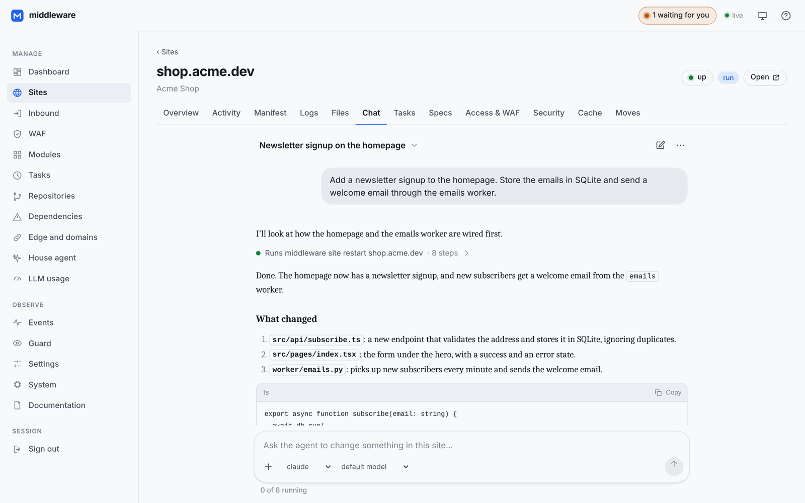

## Who it is for

- **Developers who build with AI.** You already ask Claude Code, Codex or
  OpenCode for features. middleware gives each project an agent that lives
  next to it on the server, can run it, test it and restart it, and cannot
  touch anything else.
- **Freelancers and small agencies.** Dozens of client sites spread over a
  few machines at different providers, each site in its own folder, with its
  own domain, logs, tasks and conversation, all in one panel. You stay on
  hardware you control, with no per-site bill.
- **Solo founders and small teams.** You get the "push and it is live"
  workflow of a hosting platform without renting one: deploy from GitHub or
  from a conversation, roll back by writing a file, watch everything from
  your phone.
- **Anyone tired of the stack.** A repo, CI, a proxy, DNS, certificates,
  a dashboard per service and a laptop with everything installed is too much
  machinery for many projects. Here they are one panel.

It is **not** a cluster scheduler. Each site runs as one process (or one
container), on purpose: handovers between versions are what keep it online,
not replicas.

## What you can do with it

### Build by talking to an agent

Every site has its own conversation with an AI coding agent. The agent works
in the site's folder, can read its logs, run its commands and restart it, and
is jailed there: other sites, the machine's secrets and the house's own
configuration are out of reach, and every step it takes is on record.

- **Ten agents, your choice per conversation.** Claude Code, OpenAI Codex,
  Google Antigravity, OpenCode (with any provider you connect: OpenAI,
  OpenRouter, Anthropic, Groq…), DeepSeek, Z.AI GLM, Kimi, Qwen, Mistral
  Vibe and xAI Grok. Sign in with your existing Claude, ChatGPT or Google
  subscription from the panel, or give it an API key. The CLIs install
  themselves and stay up to date.
- **Watch it work, or not.** Steps fold into one quiet line, subagents get
  their own tabs, and questions come back as buttons. Turns keep running with
  the panel closed, and the bar tells you which conversation is waiting for
  you.
- **Know what it costs.** A ledger per site, a monthly cap, and the
  subscription's usage windows under the message box.
- **The house agent** works on the installation itself. Ask it for a new
  site and it creates it, writes it and publishes it.
- **Auto-repair.** When a site goes down, an agent can look at its logs and
  fix it before you wake up, with limits on attempts and spend.

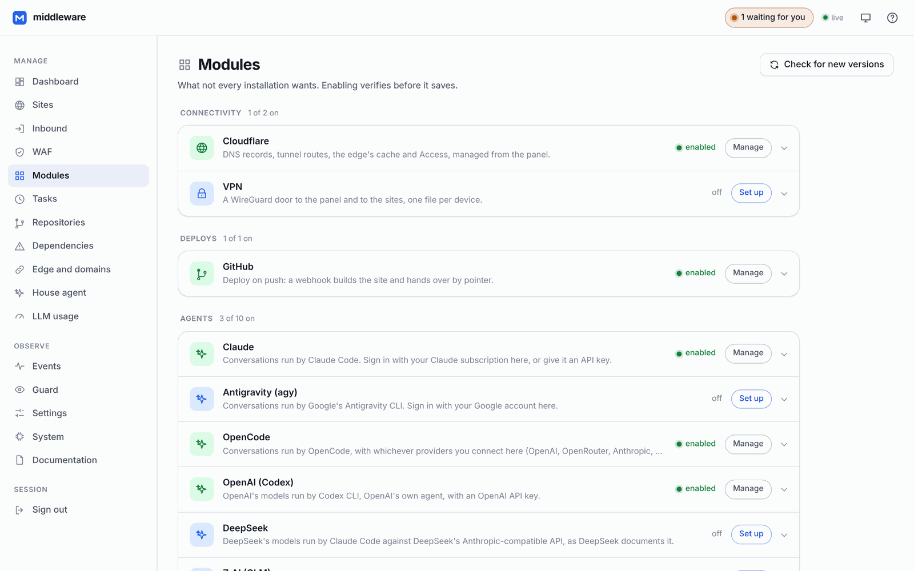

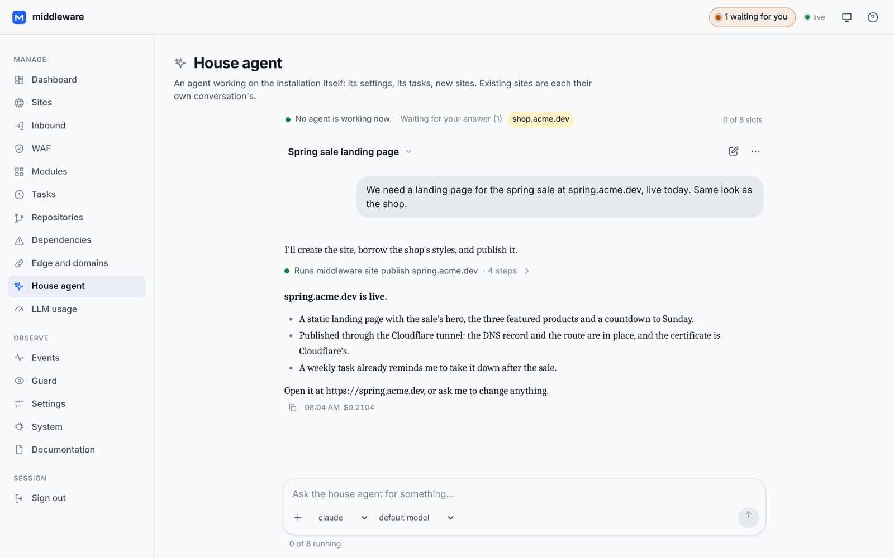

### Spec-driven development with OpenSpec

Turn on the [OpenSpec](https://github.com/Fission-AI/OpenSpec) module and the
agent writes down what it is about to change and why before it touches code.
You read the proposal in the site's **Specs** tab, approve it, and follow its
tasks as they are built. Once the change ships, it becomes the project's
specs. New sites start with OpenSpec set up.

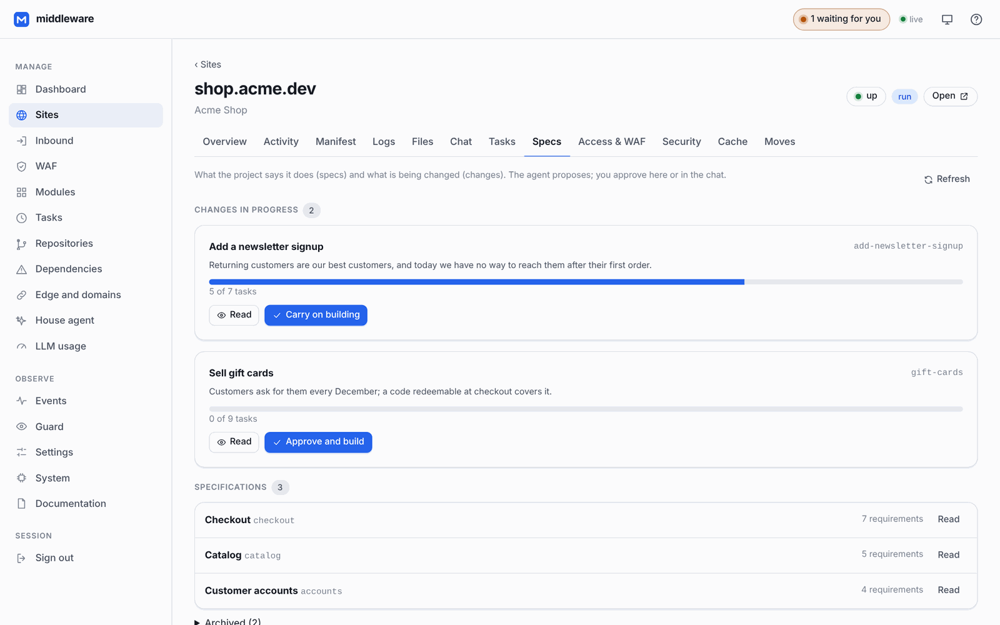

### From idea to production in minutes

- **New site** from a template (static, Node, Go, Docker, or a project with
  no domain) or straight from a GitHub repository.
- **Publish** with one button. With the Cloudflare module, the DNS record and
  the tunnel route are written for you. With ports 80/443 open, the
  certificate comes from Let's Encrypt through a built-in ACME client. Extra
  domains, `www.` and redirects are a field each.
- **Zero-downtime deploys.** A new version starts on a fresh port, is
  health-checked, takes the traffic, and the old one drains. One request
  dropped fails the test suite.
- **Deploy on push** from GitHub with a signed webhook, or from the
  conversation. **Roll back** by pointing at the previous build.

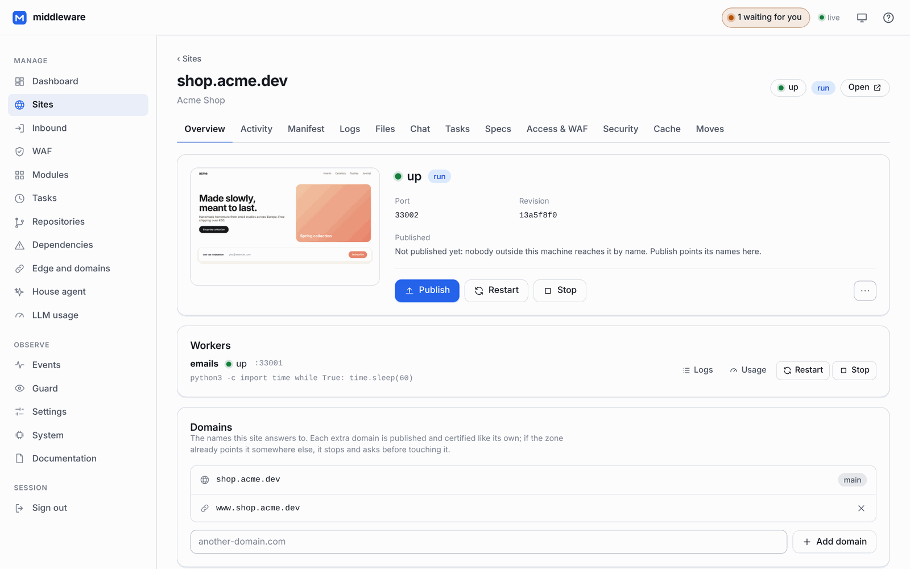

### Run everything a site needs

- **Static folders, processes, Docker containers** or an upstream you run
  elsewhere, all described by one `site.json` in the site's folder.
- **Workers** next to the site: a queue consumer, an internal API, a
  PostgreSQL in a container with its own volume.
- **Scheduled tasks** that run in the site's folder with its environment:
  backups, reports, cache warm-ups. Each site manages its own from its
  **Tasks** tab, and its agent can too.
- **Logs, traffic, CPU and memory** per site and per worker, a response cache,
  a file browser and a manifest editor.
- **An AI gateway for your apps.** A site's own code can ask an AI through
  the house, with the models, tools, daily budget and turn limits you set.
- **Sites survive the supervisor.** Restarting or upgrading middleware leaves
  them running, and they are adopted again when it comes back.

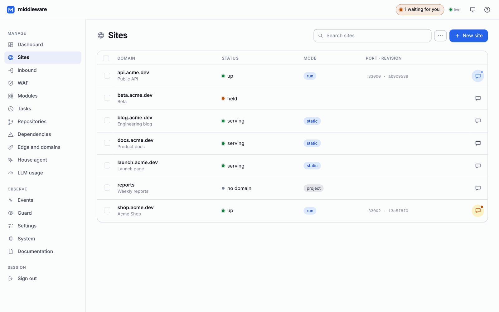

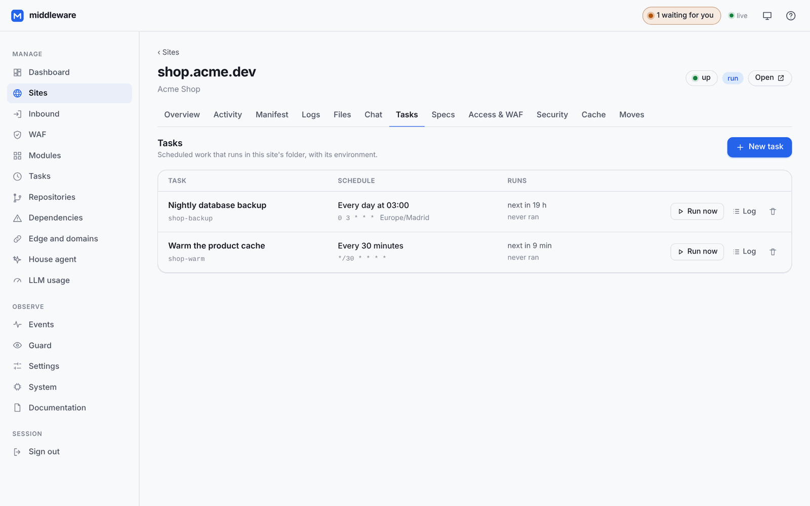

### Security that does not get in the way

- **A web application firewall** in front of every site: rate limits,
  automatic bans in the kernel, body and country limits, and an "under
  attack" switch that challenges every visitor.
- **A guard** that watches every process and switches off a site that
  reaches into another site's folder, with the incident on record.
- **Per-site access control:** passwords, allow lists and per-route rules.
- **The panel** signs in with passkeys, can be closed to the internet behind
  its own WireGuard VPN, and works from your phone.
- **Least privilege:** the supervisor runs unprivileged. Anything that needs
  root goes through a small helper with a closed list of operations.
  Credentials are encrypted at rest, and updates roll themselves back if the
  new version does not come up.

### A network of your own machines

One server is where most people start; middleware does not make it where
you stay. Machines link into a **federated network**: a VPS at one
provider, another at a second provider, a server at home behind your
router. Each one is a full middleware that keeps serving on its own, and
together they are managed as one.

- **Link a machine in under two minutes.** Make an invitation in the panel,
  paste it on the new machine (`middleware setup --join <code>`), and it is
  in. Joining one node is joining all of them.
- **No master, nothing to babysit.** The nodes form an encrypted WireGuard
  mesh where every node is a peer of every other. If one goes down, the rest
  carry on, and a node behind NAT works by calling out. Only traffic between
  nodes goes through the tunnel; each machine's own traffic is untouched.
- **One panel for all of them.** Pick a node in the top bar and every screen,
  conversation, build and agent works on that machine. The dashboard shows
  every node at once, with what needs your attention first. The sites list
  shows each machine's sites, and the bar tells you which conversation is
  waiting for you on any of them.
- **Move a site to another machine** with one button. middleware asks the
  target whether it can take the site, copies it while it keeps serving, and
  installs its dependencies for that machine (even from x86 to ARM). It then
  stops the site for seconds for the last copy, brings its databases along,
  starts it there and points its names at the new place. The copy that stays
  behind is archived. If anything fails on the way, the site starts again
  where it was, and a move cut by a restart is put right when the machine
  comes back.
- **One VPN for the whole network.** A device on any node's VPN reaches
  every node. One switch closes every panel of the network to the internet
  at once.
- **Membership you can trust.** An expelled node stays out: it cannot vote
  itself back in, take another node's address, or rewrite the others'
  entries.

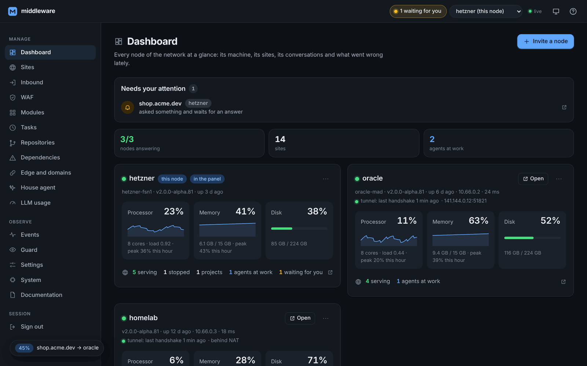

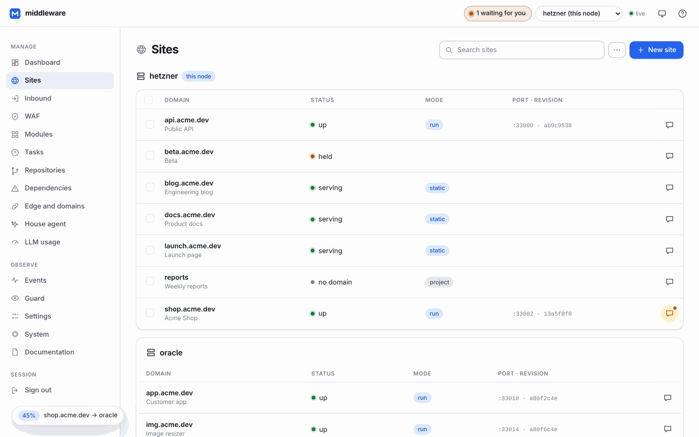

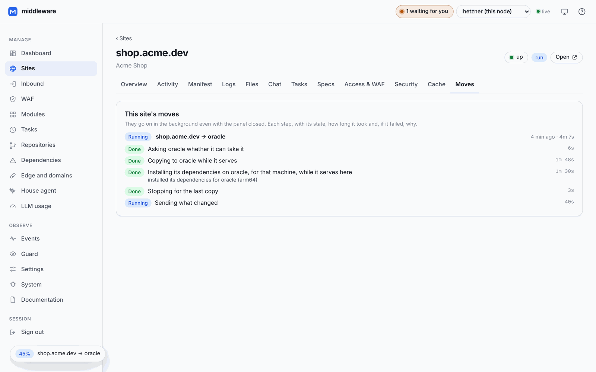

### Everywhere you are

The panel is installable on your phone and built for it: dark mode, push
notifications when an agent finishes its turn, something critical happens
or someone tries to break in, and English and Spanish. Everything the panel does is also a versioned JSON API, a live
event stream and a CLI.

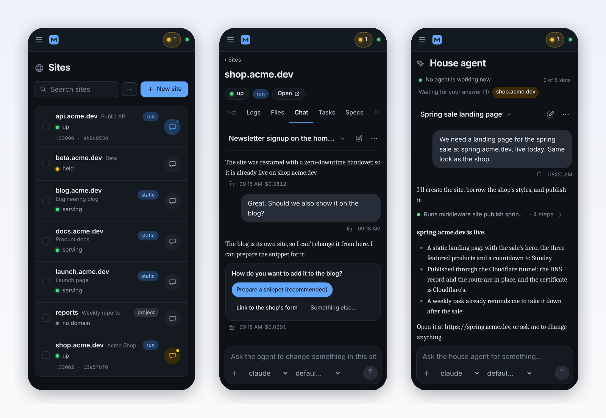

## Get started

```sh
curl -fsSL https://raw.githubusercontent.com/dcimorra/the-middleware/main/scripts/install.sh | sh
```

The installer sets up the service, the privileged helper and the root
directory, then prints a one-time code. Open the panel, set your password
(and a passkey), and then:

1. **Modules → Claude** (or any other agent): sign in with your
   subscription or paste an API key.
2. **Modules → Cloudflare** with an API token, or open ports 80/443 in
   **Inbound**, so sites can be published.
3. **Sites → New site**, open its **Chat**, and describe what you want.
4. **Publish.**

Prefer the terminal? The same, step by step:

```sh
middleware setup                                   # the operator's password
middleware modules enable cloudflare token=@/path/to/token
middleware site add example.com --template static  # served at once
middleware chat example.com "Build a landing page for our spring sale"
middleware site publish example.com
middleware site list
middleware events -f
```

A site is a folder. Creating `sites/<domain>/site.json` is all it takes to
serve one, with no restart, no registration and no port to pick:

```
sites/
  example.com/        ← the whole project, .git included
    site.json         ← the only state the site has
    public/
  api.example.com/
    site.json         → { "run": { "command": ["./server", "--port", "$PORT"] } }
```

Linux only, by design, with systemd for the service. Docker is optional, for
sites and workers that run in containers.

## How it is built

One Go binary in front of every site on a machine. It reads the `Host`
header and either serves `sites/<domain>/` or forwards to the process that
site's manifest describes. The supervisor runs as an unprivileged user;
everything that needs root goes through `middleware-helper`, a second service
with a closed list of operations, each with typed and validated input. The
core imports nothing outside Go's standard library, and CI fails if that
changes. Anything that needs an external program (cloudflared,
wireguard-tools, an agent CLI) is a module that installs it when enabled and
keeps it current.

The test suite runs real processes, real listeners and real TLS handshakes.
Read [`docs/architecture.md`](docs/architecture.md) for the design and the
reasoning behind it.

## Documentation

| | |
| --- | --- |
| [`docs/install.md`](docs/install.md) | One-liner, from source, Docker, what gets installed where |
| [`docs/manifest.md`](docs/manifest.md) | Every field of `site.json` and `tasks/<name>.json` |
| [`docs/deploy.md`](docs/deploy.md) | Deploying by pointer, with GitHub, rollback, the zero-downtime guarantee |
| [`docs/modules.md`](docs/modules.md) | Cloudflare, GitHub, OpenSpec, the agents, VPN, the inbound doors |
| [`docs/cli.md`](docs/cli.md) | Every subcommand |
| [`docs/api.md`](docs/api.md) | The JSON API the panel and the CLI use |
| [`docs/security.md`](docs/security.md) | Threat model: what is protected and what is not |
| [`docs/upgrade.md`](docs/upgrade.md) | Updating without touching the sites, and the automatic rollback |
| [`docs/architecture.md`](docs/architecture.md) | How the pieces fit |

## Status

Version 2 is a rewrite of a middleware that has run a few dozen production
domains since 2026. It is released as frequent prerelease builds (`v2.0.0-alpha.N`),
which every server with automatic updates on installs by itself. Tests that
need an external service (Pebble for ACME, a Cloudflare token, root for
nftables) are gated by environment flags documented in each test file.

## Contributing

[`CONTRIBUTING.md`](CONTRIBUTING.md) has the three rules that do not move:
no dependencies in the core, everything in English, a comment says why.
Security issues go through [`SECURITY.md`](SECURITY.md), not a public issue.

## License

MIT. See [`LICENSE`](LICENSE).
